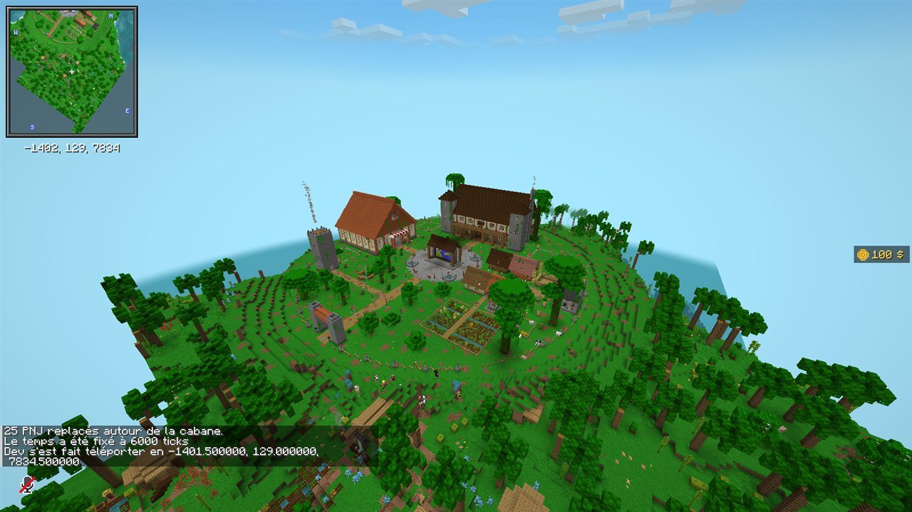
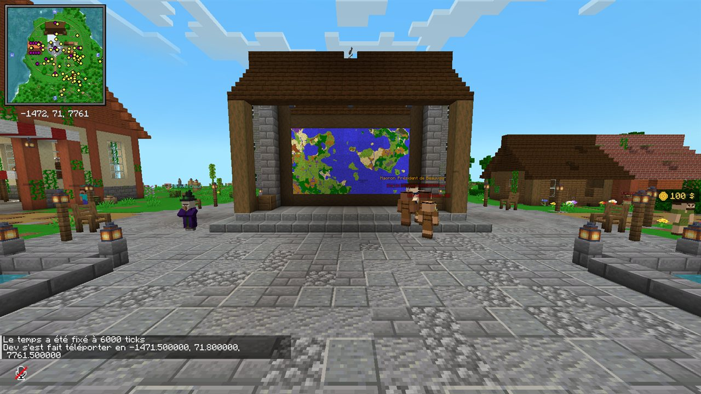
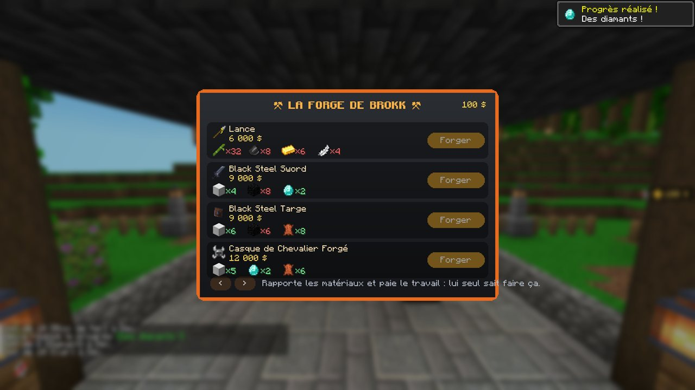
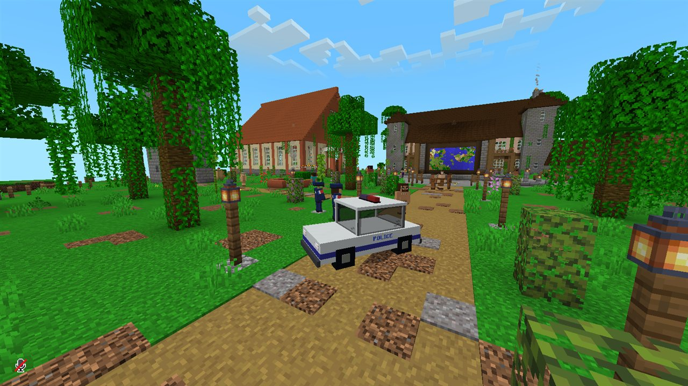
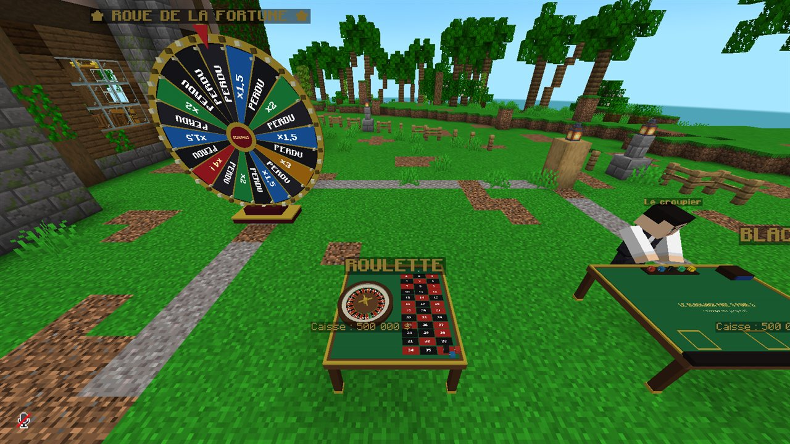
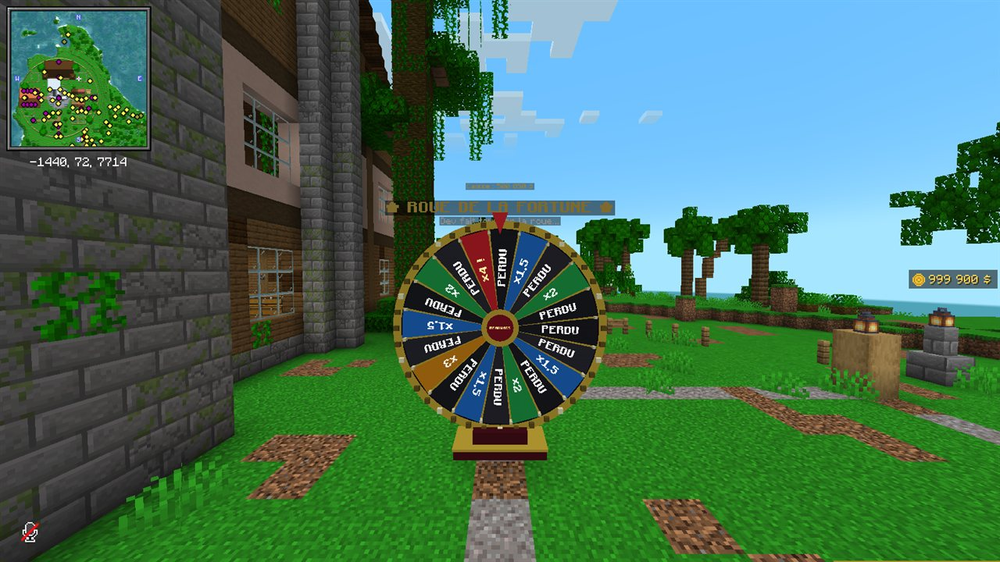
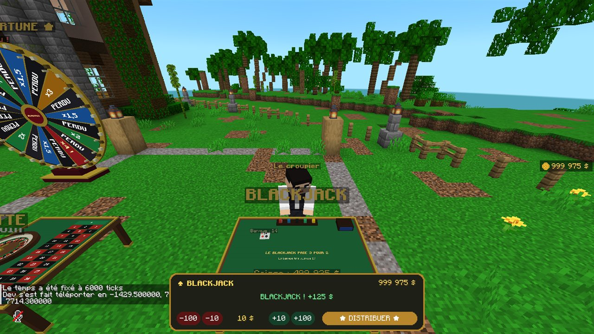

# Beauvais — serveur Minecraft entre potes

Survie moddée en **NeoForge 1.21.1** (la même base que CrazyTown S3). Votre avion prend feu au-dessus de la jungle ; vous sautez en parachute et vous atterrissez à **Beauvais**, un village perdu au milieu d'arbres géants. Des PNJ, une grande quête qui envoie dans des donjons partout sur la map, des téléphones avec numéros perso et vocal, un casino, une police, et un président.

Le dépôt et le mod s'appellent encore `la-cabane` / `mod-cabane` : c'est le nom de départ, ça ne se voit pas en jeu.

## Aperçu en jeu

Captures prises automatiquement dans le jeu de test (`docs/apercu/`).









## Comment ça marche

```
Toi (Prism)  ──publier.bat──►  GitHub (pack/)  ◄──au lancement──  Prism de tes potes
                                     ▲
                                     └──────au démarrage──────  Serveur
```

- `pack/` : la liste des mods (format [packwiz](https://packwiz.infra.link)), les configs et le livre de quêtes. C'est la seule chose que tes potes et le serveur téléchargent.
- `mod-cabane/` : notre mod maison (téléphone, village, PNJ, casino, police…).
- `outils/` : les scripts. Les fichiers `.bat` à la racine sont là pour lancer ces scripts en double-cliquant.

## Pour tes potes (une seule fois)

1. Installer [Prism Launcher](https://prismlauncher.org) et se connecter avec son compte Microsoft (il faut posséder Minecraft Java).
2. Importer `La Cabane.zip` dans Prism (Ajouter une instance → Importer).
3. Lancer. Les mods se téléchargent tout seuls, et à chaque lancement ils se mettent à jour.

Prévoir 8 Go de RAM pour l'instance (réglé par défaut).

## Pour toi

| Fichier | À quoi il sert |
|---|---|
| `installer-outils.bat` | Installe Java 21, Go et packwiz dans `.outils/` (seulement sur un nouveau PC). |
| `compiler.bat` | Compile le mod maison et le met dans le pack. |
| `publier.bat` | Compare les mods de **ton** instance Prism avec le pack, met le pack à jour et l'envoie sur GitHub. `publier.bat --essai` montre seulement ce qui changerait. |
| `construire-instance.bat` | Refait `dist/La Cabane.zip`, à envoyer aux potes. |
| `tester-en-jeu.bat` | Lance le jeu de développement avec tous les mods du pack et la dernière version du mod maison (compilée au passage). Le compte est un compte de test hors ligne : pas de serveur en ligne avec. |

**Ajouter ou retirer un mod** : fais-le dans ton Prism, puis double-clique sur `publier.bat` **avant** de relancer le jeu. Sinon, au lancement, le pack remet les mods comme avant. Les mods qui ne sont que sur CurseForge doivent être ajoutés à la main :

```bash
cd pack
../.outils/gopath/bin/packwiz.exe curseforge add <nom-du-mod>
```

## Le départ : la salle d'embarquement et `/start`

- Tant que l'hôte n'a pas lancé la partie, tout le monde attend dans la **salle d'embarquement**, au bout de la passerelle de l'avion (mode aventure, on ne casse rien).
- Quand tout le monde est là, l'hôte tape **`/start`** : la porte s'ouvre, chacun se retrouve dans l'avion à 270 blocs de haut, avec un parachute. Il n'y a plus qu'à sauter.
- Ensuite, on réapparaît toujours dans l'avion… sauf si on a dormi dans un lit.

## Le village de Beauvais

Au tout premier démarrage du serveur, le mod cherche une grande jungle (biomes géants : jungle, savane, désert, volcans, neige) et y construit Beauvais, en grand (130 blocs de large) :

- **au centre**, une grande place pavée avec quatre fontaines et le **grand panneau de la carte** ;
- **au nord**, la **Grande Cabane**, la base des joueurs : grande salle, cuisine, bibliothèque, coffres, **mur des reliques**, dortoir, atelier ;
- **à l'ouest**, le **Grand Bazar** : le comptoir de Mouloud, le tableau des contrats de Mehdi (les contrats de l'heure s'affichent au-dessus, avec le compte à rebours ; clic droit pour livrer), et des emplacements d'étals ;
- **à l'est**, la rue : des maisons usées par le temps, un chantier, la **forge de Brokk** ;
- **au sud**, les champs, le puits, l'enclos, le feu de camp, la tour de guet et la **grande porte** ;
- des **terrains à vendre** : une borne « À VENDRE » avec le prix (maisons 5 000 $, parcelles 8 000 $, grands terrains commerciaux 20 000 $). Clic droit deux fois pour acheter ; la borne affiche ensuite le nom du propriétaire.

Les PNJ (Easy NPC) :

- **le Hejj du Village**, le sage, devant la Grande Cabane (il donnera les grandes quêtes) ;
- **Karim le Chouf**, au grand panneau, qui donne les cartes au trésor ;
- **Mouloud le Marchand** et son cousin **Gribbs**, au Grand Bazar ;
- **Mehdi de Pôle emploi**, au tableau des contrats ;
- **Brokk le Forgeron**, et sa **forge spéciale** : il fabrique des armes et armures rares des mods (lance Umvuthana, épée d'acier noir, hache du Wroughtnaut, gantelet de la Terre, masque du Soleil, forge infernale…). Il faut lui rapporter les matériaux et payer le travail ; lui seul sait les faire. Les recettes sont dans `mod-cabane/src/main/resources/data/cabane/forge/` ;
- **Ovsie la Fée**, **Nyota la Guérisseuse**, les gardes de la grande porte ;
- **les habitants** : Jean, Jacques, Francis, Louis, Bernard, Gérard, Ginette, Monique, Martine et Thierry. Ils se baladent autour de chez eux et se méfient des nouveaux ;
- **Macron, Président de Beauvais**, sur la place, et ses **quatre gardes présidentiels**. Ils sont invincibles : qui frappe le Président (ou un garde) est pris en chasse pendant deux minutes. Ils finissent par se calmer.

Commandes admin :

- `/start` lance la partie (l'hôte seulement) ;
- `/cabane placer` reconstruit le village à tes pieds et y déplace le spawn ;
- `/cabane pnj` fait revenir les PNJ ;
- `/cabane garde <joueur>` lâche la garde présidentielle sur quelqu'un.

## Le téléphone

- Chaque nouveau joueur en reçoit un ; les suivants s'achètent chez Mouloud (pas de recette). Touche **N** ou clic droit.
- **La SIM est gravée dans le téléphone** : la première fois, tu choisis un numéro à 3 ou 4 chiffres, et il ne changera plus. Un autre numéro, c'est un autre téléphone. Le téléphone garde sa mémoire (contacts, récents, photos, compte Piaf) : si on te le vole, on peut se faire passer pour toi.
- Compose un numéro → ça sonne chez l'autre (les joueurs autour l'entendent aussi). On peut appeler **en numéro masqué**. Vous vous entendez partout sur la map grâce à Simple Voice Chat.
- Les applis, façon iPhone : **Clavier**, **Contacts**, **Récents**, **Piaf** (le réseau social), **Photo** (un viseur, puis clic pour déclencher) et **Galerie**, **Argent**, **Réglages**.

## L'argent, la boutique et le casino

- La monnaie : les SakaiDollars ($). On en gagne avec les contrats de Mehdi, on se paie entre joueurs avec `/payer`.
- La boutique de Mouloud vend le téléphone, les boosters de cartes (animations de révélation, la carte la plus rare toujours en dernier), les puffs et la chicha, les étals, la police… et le casino.
- **Le casino** coûte cher (4 000 à 12 000 $ la table) : c'est le gérant qui l'installe. Chaque jeu a sa **caisse** : le gérant la remplit et récupère l'argent (accroupi + clic droit). Si la caisse ne couvre pas le gain possible, la mise est refusée.
- **Les grandes tables** : la **roulette** (2 x 2) avec son cylindre qui tourne en vrai et la bille qui tombe dans la case, la **roue de la fortune** (5 x 5) avec ses lumières et son feu d'artifice au jackpot, et le **blackjack** (3 x 2) avec un croupier : jusqu'à trois joueurs assis, les cartes de chacun sont posées sur le tapis.
- Les **tickets à gratter**, à gratter vraiment à la souris.

## La police

Chez Mouloud : les **menottes** (clic droit sur un joueur : il est menotté et suit son policier ; encore un clic pour le libérer), le **pistolet** (100 balles, rechargement infini, aucun dégât : la cible brille et ralentit), la **tenue de police** (clic droit : on l'enfile d'un coup ; presque aucune protection) et la **voiture de police** (sans essence, quatre places, ZQSD pour conduire, **H** pour la sirène, accroupi + frapper pour la ranger).

## Les quêtes (FTB Quests)

- **Beauvais** : l'arrivée, le premier coup de fil, les Waystones, le sac à dos, la cuisine, Create.
- **Les Sept Reliques** : pour chaque relique, un indice qui donne une carte au trésor, puis le donjon à trouver, puis la relique (cachée dans le coffre au trésor de ce donjon). Avec les sept, on obtient « Le Réveil de la Cabane » et des élytres.
- **Les Grands Donjons** : 12 donjons géants à visiter et 12 boss (Cataclysm, Mowzie's Mobs).

Pour modifier les quêtes, utilise le livre en jeu (en op, mode édition), ou modifie `outils/generer-quetes.mjs` puis lance `node outils/generer-quetes.mjs`.

## Les mods principaux

- **Monde** : Terralith + Tectonic (relief), YUNG's (temples, donjons, forteresses), When Dungeons Arise, IDAS, Dungeons & Taverns, Towns & Towers, CTOV, MVS, Structory, Explorify, Cataclysm, Lootr (butin par joueur).
- **Animaux** : Naturalist, Critters & Companions, Mowzie's Mobs, Ecologics, Creeper/Enderman Overhaul, WilderNature, Mutant Monsters.
- **Façon CrazyTown** : Create, Simple Planes, Woodwalkers, MrCrayfish Furniture, Handcrafted, Macaw's, Supplementaries, Sophisticated Backpacks/Storage, Waystones, Emotecraft, Camera Mod, Simple Hats, Etched, Goblin Traders, Farmer's Delight, Carry On, Comforts.
- **Confort** : Simple Voice Chat, Sound Physics, JEI, Jade, Xaero's Minimap et World Map, AppleSkin, Open Parties and Claims, Sodium, Iris et les mods d'optimisation.

La liste complète est dans `pack/mods/`.

## Le serveur

On choisira l'hébergeur plus tard. Il devra accepter nos propres mods (donc pas Aternos) et ouvrir le **port UDP 24454** pour Simple Voice Chat.

**La map est prête à l'avance** : `dist/Beauvais - monde.zip` contient le monde avec Beauvais déjà construit, ses PNJ, et 1 000 blocs de jungle tout autour déjà générés (pas d'attente au premier lancement, tout le monde voit la même map). Au-delà, le monde continue de se générer normalement quand on explore. Pour l'installer sur le serveur : décompresser le zip dans le dossier du serveur, puis dans `server.properties` :

```
level-name=monde-beauvais
level-type=minecraft:large_biomes
level-seed=lacabane2026
```

Sans ce zip, le serveur construit le village tout seul au premier démarrage (une à deux minutes).
