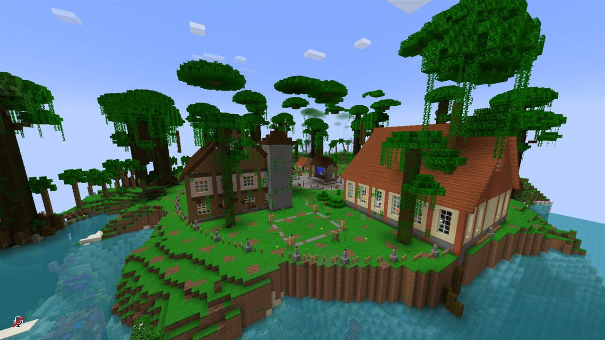
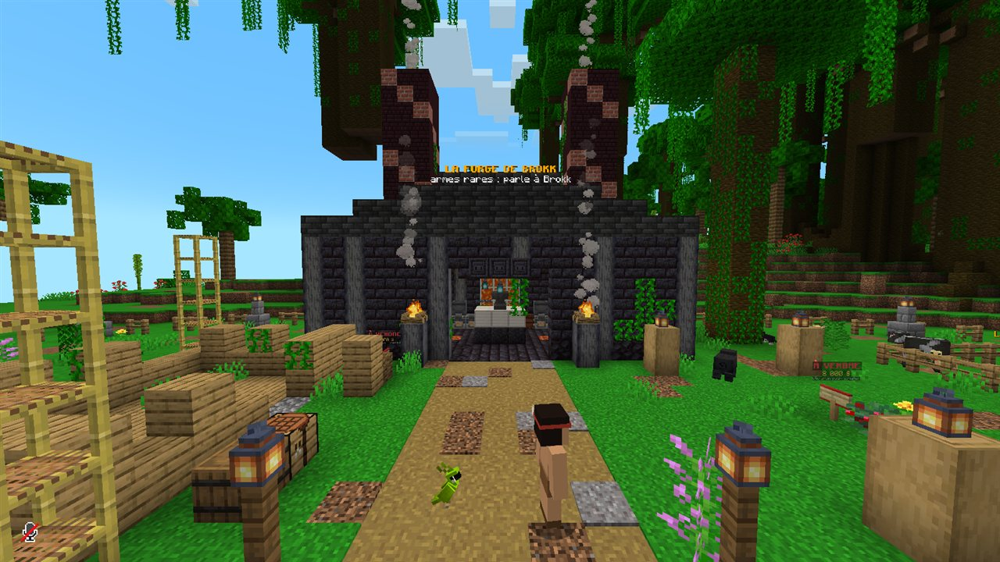
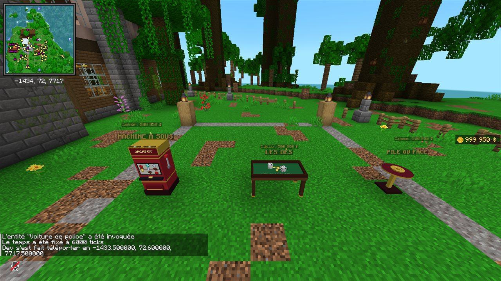
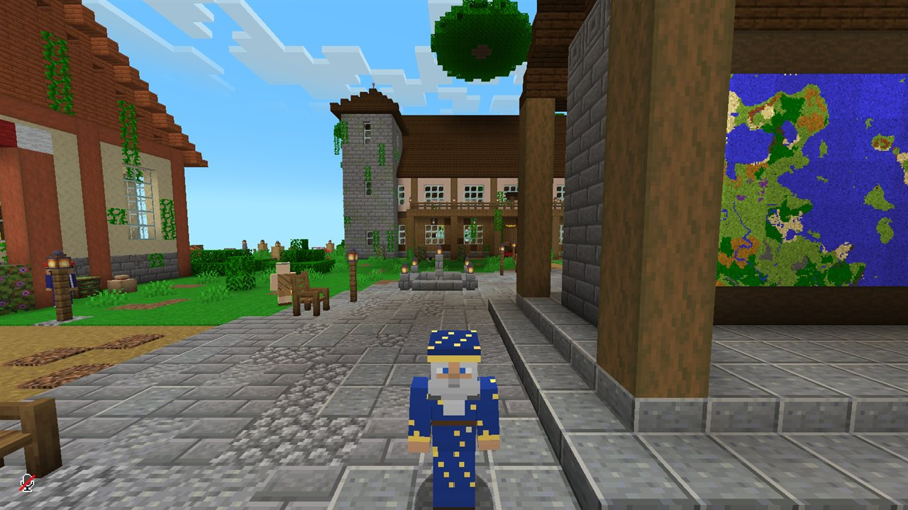
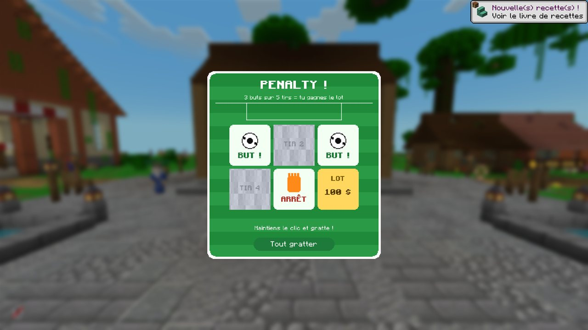
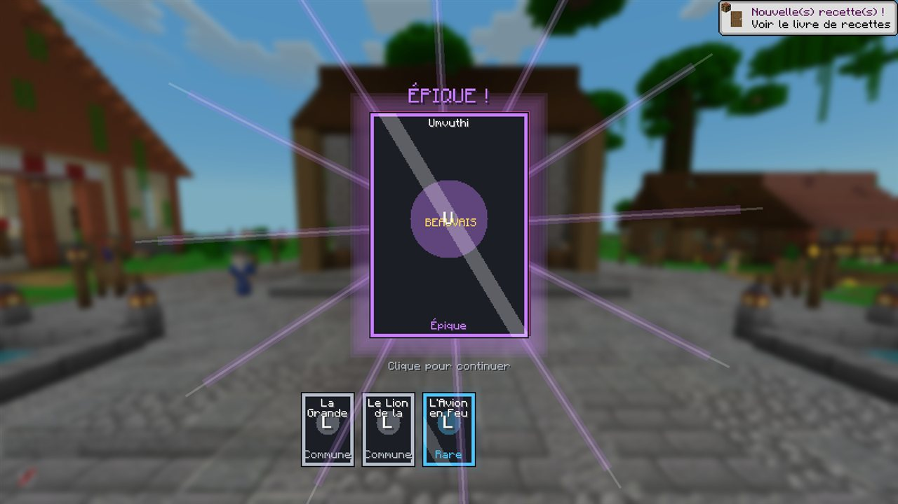

# Beauvais — serveur Minecraft entre potes

Survie moddée en **NeoForge 1.21.1** (la même base que CrazyTown S3). Votre avion prend feu au-dessus de la jungle ; vous sautez en parachute et vous atterrissez à **Beauvais**, un village perdu au milieu d'arbres géants. Des PNJ, une grande quête qui envoie dans des donjons partout sur la map, des téléphones avec numéros perso et vocal, un casino, une police, et un président.

Le modpack et notre mod maison s'appellent **SakaiMod**. Le dépôt et le dossier s'appellent encore `la-cabane` / `mod-cabane` : ça ne se voit pas en jeu.

## Aperçu en jeu

Captures prises automatiquement dans le jeu de test (`docs/apercu/`).









## Comment ça marche

```
Toi (Prism)  ──publier.bat──►  GitHub (pack/)  ◄──au lancement──  Prism de tes potes
                                     ▲
                                     └──────au démarrage──────  Serveur
```

- `pack/` : la liste des mods (format [packwiz](https://packwiz.infra.link)), les configs et le livre de quêtes. C'est la seule chose que tes potes et le serveur téléchargent.
- `mod-cabane/` : notre mod maison (téléphone, village, PNJ, casino, police…).
- `outils/` : les scripts. Les fichiers `.bat` à la racine sont là pour lancer ces scripts en double-cliquant.

## Pour tes potes (une seule fois)

1. Installer [Prism Launcher](https://prismlauncher.org) et se connecter avec son compte Microsoft (il faut posséder Minecraft Java).
2. Importer `SakaiMod.zip` dans Prism (Ajouter une instance → Importer).
3. Lancer. Les mods se téléchargent tout seuls, et à chaque lancement ils se mettent à jour.

Prévoir 8 Go de RAM pour l'instance (réglé par défaut).

## Pour toi

| Fichier | À quoi il sert |
|---|---|
| `installer-outils.bat` | Installe Java 21, Go et packwiz dans `.outils/` (seulement sur un nouveau PC). |
| `compiler.bat` | Compile le mod maison et le met dans le pack. |
| `publier.bat` | Compare les mods de **ton** instance Prism avec le pack, met le pack à jour et l'envoie sur GitHub. `publier.bat --essai` montre seulement ce qui changerait. |
| `construire-instance.bat` | Refait `dist/SakaiMod.zip`, à envoyer aux potes. |
| `tester-en-jeu.bat` | Lance le jeu de développement avec tous les mods du pack et la dernière version du mod maison (compilée au passage). Le compte est un compte de test hors ligne : pas de serveur en ligne avec. |

**Ajouter ou retirer un mod** : fais-le dans ton Prism, puis double-clique sur `publier.bat` **avant** de relancer le jeu. Sinon, au lancement, le pack remet les mods comme avant. Les mods qui ne sont que sur CurseForge doivent être ajoutés à la main :

```bash
cd pack
../.outils/gopath/bin/packwiz.exe curseforge add <nom-du-mod>
```

## Le départ : la salle d'embarquement et `/start`

- Tant que l'hôte n'a pas lancé la partie, tout le monde attend dans la **salle d'embarquement**, au bout de la passerelle de l'avion (mode aventure, on ne casse rien).
- Quand tout le monde est là, l'hôte tape **`/start`** : la porte s'ouvre et la **cinématique du décollage** commence pour tout le monde (1 min 40). On embarque par la passerelle, chacun avec son skin (des passagers inconnus remplissent les sièges vides), on voit les pilotes, l'avion décolle ; dans la cabine on discute avec ses voisins, l'hôtesse passe avec son chariot… puis l'orage, les secousses, une nuée de phantoms dans le réacteur droit. Écran noir : chacun se réveille dans l'avion en feu, à 270 blocs de haut, avec un parachute. Il n'y a plus qu'à sauter.
- Pendant les scènes de l'aéroport, une musique passe en fond : elle est seulement dans le pack de sons privé « Beauvais - voix » (`voix/cinematique/aeroport.ogg`), jamais sur GitHub.
- Ensuite, on réapparaît toujours dans l'avion… sauf si on a dormi dans un lit.
- **En solo**, toutes les commandes (`/start`, `/cabane…`) marchent toujours, même sans avoir activé la triche. **Sur un serveur**, elles restent réservées aux admins.

## Le village de Beauvais

Au tout premier démarrage du serveur, le mod cherche une grande jungle (biomes géants : jungle, savane, désert, volcans, neige) et y construit Beauvais, en grand (130 blocs de large) :

- **au centre**, une grande place pavée avec quatre fontaines et le **grand panneau de la carte** ;
- **au nord**, la **Grande Cabane**, la base des joueurs : grande salle, cuisine, bibliothèque, coffres, **mur des reliques**, dortoir, atelier ;
- **tout autour du vieux centre**, un **boulevard** et une couronne de **terrains à bâtir** (une borne « à vendre » chacun) pour les commerces des joueurs ; la palissade et la grande porte sont plus loin, le village fait trois fois la taille d'avant ;
- **à l'ouest**, le **Grand Bazar** : le comptoir de Mouloud, le tableau des contrats de Mehdi (les contrats de l'heure s'affichent au-dessus, avec le compte à rebours ; clic droit pour livrer), et des emplacements d'étals ;
- **à l'est**, la rue : des maisons usées par le temps, un chantier, la **forge de Brokk** ;
- **au sud**, les champs, le puits, l'enclos, le feu de camp, la tour de guet et la **grande porte** ;
- des **terrains à vendre** : une borne « À VENDRE » avec le prix (maisons 5 000 $, parcelles 8 000 $, grands terrains commerciaux 20 000 $). Clic droit deux fois pour acheter ; la borne affiche ensuite le nom du propriétaire.

Les PNJ (Easy NPC) :

- **Marcel le Conteur**, au feu de camp : c'est par lui que commence l'histoire de Beauvais ;
- **le Hejj du Village**, le sage, devant la Grande Cabane (il donnera les grandes quêtes) ;
- **Karim le Chouf**, au grand panneau, qui donne les cartes au trésor ;
- **Mouloud le Marchand** et son cousin **Gribbs**, au Grand Bazar ;
- **Mehdi de Pôle emploi**, au tableau des contrats ;
- **Brokk le Forgeron**, un énorme orque de guerre (5 blocs de haut, 6 avec ses cornes : voir `docs/brokk/planche-brokk.png`), et sa **forge spéciale**, en trois onglets. **Armes** : des pièces vanilla signées Brokk et enchantées (épée, hache de guerre, arc, arbalète, trident, masse) et celles des mods (lance Umvuthana, dague de Naga, épée d'acier noir, khopesh, lame corrompue, marteau de Hulk…). **Armures** : le casque, le plastron, les jambières et les bottes de Brokk, son plastron de netherite, son bouclier, et les armures des mods (masques Umvuthana, robe du géomancien, armure de squelette mutant, plastron de crocodile, élytres de tarantule…). **Reliques des boss** : les armes des boss (Wroughtnaut, Sculptrice, Barako, Ignis, Scylla, le Léviathan, la Monstruosité, le Harbinger, le Ver du Vide…), que Brokk refait sans qu'on ait à battre le boss. Les matériaux sont logiques (le feu des blazes et le magma pour Ignis, le cuivre et les paratonnerres pour Scylla, l'obsidienne et l'œil de l'Ender pour le Vide…) mais jamais un butin de boss ; les reliques coûtent de 12 000 à 120 000 $. Ensuite, **on le regarde forger** : la pièce rougit sur l'enclume monumentale, son marteau se lève et retombe dans les étincelles, la pièce est trempée dans la vapeur puis s'élève au-dessus de l'enclume, et Brokk te la tend (de 15 s à une minute ; une barre en haut de l'écran montre où il en est). Une seule pièce à la fois sur l'enclume : les commandes suivantes attendent leur tour, et une pièce finie attend son propriétaire à la forge. Les recettes sont dans `mod-cabane/outils/forge.mjs` ;
- **Ovsie la Fée**, **Nyota la Guérisseuse**, les gardes de la grande porte ;
- **les habitants** : Jean, Jacques, Francis, Louis, Bernard, Gérard, Ginette, Monique, Martine et Thierry. Ils se baladent autour de chez eux et se méfient des nouveaux ;
- **Vegeta**, qui s'entraîne près de la tour de guet (« ma stupide fierté… ») ;
- les **orques de Brokk** (Grosh, Mog et Urga), qui travaillent dans sa forge ;
- **Macron, Président de Beauvais**, sur la place, et ses **quatre gardes présidentiels**. Ils sont invincibles : qui frappe le Président (ou un garde) est pris en chasse pendant deux minutes. Ils finissent par se calmer ;
- **Sylvie**, la femme de Pierre, qui se balade sur la place avec leur fils **Lucas**, un gamin qui la suit partout (voir « Où est Pierre ? ») ;

Chaque PNJ a plusieurs répliques, tirées au hasard à chaque fois qu'on lui parle. On peut les frapper (ils rougissent et reculent), mais ils ne meurent jamais. Quand le mod est mis à jour, les PNJ du village sont remplacés tout seuls au démarrage suivant.

### Parler aux habitants : boutiques, services et missions

Un clic droit sur un habitant ouvre sa conversation (le mod l'affiche lui-même : portrait, nom, texte qui s'écrit, réponses numérotées, touches 1 à 9). Tout ce qu'il propose marche directement depuis la conversation :

- **les boutiques** (pastille « $ ») : Mouloud, Gribbs (et ses secrets à 15 $), Jean-Mi (boosters), Karim (boussole, longue-vue, lit, Waystone, sac… et les **cartes au trésor des sept reliques**, 300 $ la carte), Ovsie (potions), Nyota (remèdes), le Fourgue (marché noir) ;
- **les services** : la forge de Brokk (et ses orques y renvoient), les contrats de Mehdi, la demande du jour du Hejj, les **soins de Nyota** (40 $ : toute la vie et plus aucun effet négatif, gueule de bois comprise), le livre de quêtes ouvert au bon chapitre (le Hejj, Marcel) ;
- **les missions** : ceux qui ont besoin de toi ont un « ! » doré. On lit ce qu'ils demandent et ce qu'on y gagne, on accepte, et la mission s'affiche en haut à droite de l'écran avec sa progression (apporter des objets, vaincre des monstres, poser une question à quelqu'un, trouver un lieu…). Un « ? » gris : en cours. Un « ✔ » vert : c'est fait, va la rendre. Il y en a 35 : le tour du village du Hejj, une par habitant (le balai de Jacques, le singe de Bernard, l'entraînement de Vegeta, le géant de fer de Brokk, les Foliaaths de Bernard, les crocodiles de Jean, les mille-pattes de la mine…), et l'histoire de Pierre. `/cabane missions` les liste, `/cabane missions cacher` masque (ou remet) le suivi à l'écran. Les missions sont dans `mod-cabane/outils/missions.mjs`, les conversations dans `mod-cabane/outils/pnj.mjs`.

### Où est Pierre ?

Sylvie se balade sur la place avec Lucas (le soir, ils vont attendre devant la Mairie) : son mari Pierre est entré à la Mairie avec une pétition il y a trois semaines, et n'est jamais ressorti. Elle demande de l'aide :

1. **Où est Pierre ?** Interroger son frère Jean, Martine (qui a vu de la lumière sous la Mairie et entendu crier « Sylvie ! ») et Gribbs (qui connaît la bibliothèque qui pivote).
2. **Sous la Mairie.** Trouver le passage secret, descendre jusqu'à la cellule de Pierre ; il donne une lettre pour sa femme. Sylvie la lit…
3. **Le dessin de Lucas.** Lucas confie un dessin pour son papa (« c'est un super-héros »).
4. **Ramenez-le-nous.** Libérer Beauvais (la grande aventure du livre). Après la libération, Pierre, Sylvie et Lucas se retrouvent au feu de camp.

Autour du village, aucune structure (village, donjon, ruine…) ne s'installe dans un rayon de 400 blocs : le spawn reste propre. Et dans toutes les jungles du monde poussent des **arbres géants** au tronc de 4 x 4.

Commandes admin :

- `/start` lance la partie (l'hôte seulement) ;
- `/cabane decollage` rejoue la cinématique du décollage pour tout le monde (chacun revient ensuite là où il était) ; `/cabane decollage <seconde> <faux>` commence plus loin et ajoute des faux passagers ; `/cabane decollage reconstruire` refait l'aéroport ;
- `/cabane placer` reconstruit le village à tes pieds et y déplace le spawn ;
- `/cabane pnj` fait revenir les PNJ ;
- `/cabane garde <joueur>` lâche la garde présidentielle sur quelqu'un ;
- `/cabane raid [nombre]` lance un **raid des Pillards du Sud** sur le village (6 par défaut, un ravageur à partir de 8, un évocateur à partir de 12) ;
- `/cabane forteresse` donne les coordonnées de la Forteresse du Sud (tout le monde peut la taper) ; `/cabane forteresse ouvrir` lève la grande herse le jour du combat final, `fermer` la rescelle, `construire` la reconstruit ;
- `/cabane mairie` reconstruit la Mairie et son laboratoire (si besoin) ;
- `/cabane forge [arme|armure|relique]` ouvre la forge de Brokk (à côté de lui), sur l'onglet voulu ; `/cabane forger <recette>` commande une pièce sans passer par l'écran (pour tester) ;
- `/cabane parler <pnj>` et `/cabane dialogue <n>` : parler au PNJ le plus proche et choisir une réponse, sans clic (pour tester).

## L'histoire de Beauvais

Le chapitre de quêtes **L'Histoire de Beauvais** raconte la grande aventure, en cinq actes :

1. **Les gens du ciel.** Marcel le Conteur raconte : Beauvais était un village paisible, gouverné par le Conseil des Anciens et protégé par les Sept Reliques. Puis un homme en costume est arrivé, s'est fait Président, a suspendu le Conseil… et les Reliques ont disparu. Depuis, les **Pillards du Sud** ravagent le village et des gens disparaissent. Voilà pourquoi les villageois se méfient des étrangers. Mais une prophétie dit que « ceux qui tomberont du ciel en feu » rendront Beauvais à son peuple.
2. **Les Pillards du Sud.** On les chasse, on trouve leurs avant-postes… et l'or de la Mairie dans leurs coffres. Les **raids** sur le village, c'est l'hôte qui les lance quand il veut (`/cabane raid`).
3. **Le secret de la Mairie.** La Mairie du Président, sur la rive est de la place : salle du conseil, bureau, tableaux. Dans le bureau, une bibliothèque sonne creux : un clic, elle pivote, et une échelle descend vers le **laboratoire secret** (les « sujets » dans leurs tubes, le carnet du Président, le dossier « Projet Augmenté »). Au fond, dans sa cellule, **Pierre**, le Sujet 07, qui en sait long.
4. **Les Sept Reliques**, très loin, toutes au-delà de la zone pré-générée (de 3 500 à 7 000 blocs) : tout est à explorer. Avec les sept, Brokk forge la **Clé de la Salle Zéro**.
5. **La Forteresse du Sud**, à un peu plus de 10 000 blocs plein sud du village (sur la map fournie : **X 6976, Y 66, Z 448** ; en jeu, `/cabane forteresse` donne ses coordonnées) : une citadelle noire de 116 blocs de côté sur un terrain dégagé, une avenue qui mène à la grande herse, des tours, un donjon de 55 blocs de haut, et au cœur la **Salle Zéro**. **Pour l'instant elle est scellée** : qui essaie d'entrer est reconduit dehors (« c'est pour plus tard ! »). Le jour venu, l'hôte tape `/cabane forteresse ouvrir`, et on y va tous ensemble : la Clé sur le pupitre réveille **le Président Augmenté** (le Héraut de Cataclysm, trois fois plus solide, avec des vagues de gardes augmentés). Quand il tombe, Beauvais est libéré : il finit dans une cellule de son propre laboratoire, Pierre retrouve le feu de camp.

## Le bar : bières, vin et sodas

- **L'alcool** : bière blonde, bière brune, la fameuse **8.6**, vin rouge, pastis, rhum. Chaque verre fait monter l'**ivresse** : le hoquet, puis la tête qui tourne, la caméra qui tangue, la démarche qui titube… et le trou noir si on abuse. Au vocal, la voix d'un joueur bourré devient pâteuse et tangue (pour tout le monde, téléphone compris), jusqu'à ce que l'effet passe. Certaines donnent un petit bonus (la 8.6 et le rhum rendent plus fort, le vin soigne un peu, le pastis protège du feu).
- **Les sodas** (coca, fanta, ice tea pêche) : un coup de fouet (vitesse, saut, régénération), et ils font redescendre d'un cran.
- Tout s'achète chez Mouloud, et tout se fabrique : bouteille vide + blé + sucre (blonde), + cacao (brune), + sucre, sucre et œil d'araignée fermenté (8.6), trois baies sucrées (vin), sucre + deux fougères (pastis), cannes à sucre (rhum) ; pépite de fer + deux sucres + cacao, colorant orange ou glace pour les canettes.
- **Pour les vendre** : le marché rachète bières, vin et coca dans ses contrats, et chacun peut tenir son étal (ou ouvrir la taverne du village, une quête d'« Agrandir Beauvais »).

## Le fast-food à construire : bornes de commande, frites et burgers

Il n'y a pas de fast-food dans le village, et personne n'en parle : c'est à vous de le construire où vous voulez. Le mod fournit les bornes de commande et la carte (la borne et les plats portent le nom « McBeauvais »).

- **Les bornes de commande** : trois blocs de haut, un grand écran tactile qui fait défiler la carte. Clic droit : on choisit (menus, burgers, à côté, boissons, desserts), on remplit son panier, on paie, et le ticket sort avec son numéro ; la commande arrive deux secondes plus tard. Une borne se fabrique : fer, vitre, redstone, teintures rouge et jaune (rouge, jaune, rouge / fer, vitre, fer / fer, redstone, fer).
- **La carte** : frites (petit coup de vitesse), hamburger, cheeseburger (absorption), double cheese, **Big Beauvais** (force), **Filet-O-Fish** (respiration sous l'eau), nuggets (minage plus rapide), sundae caramel (résistance au feu), et les menus (avec Coca, Fanta ou Ice Tea). Le **P'tit Menu** contient une carte à collectionner surprise.
- **Trop de fast-food d'un coup** (cinq plats en deux minutes) : on est ballonné, ralenti et un peu nauséeux.
- **Tout se cuisine aussi** : deux patates cuites + papier (frites), pain + steak (hamburger), + seau de lait (cheeseburger, deux), cheeseburger + steak (double cheese), deux pains + deux steaks + lait + algue séchée (Big Beauvais, deux), pain + morue cuite + lait (Filet-O-Fish, deux), poulet cuit + blé (nuggets), lait + deux sucres + boule de neige (sundae, deux).

## Les quêtes de la semaine

Chaque lundi (heure de Paris), le Hejj change de thème : **les mêmes quêtes pour tout le monde**, et chacun fait les siennes. Dans sa conversation, le bouton « Les quêtes de la semaine » montre le thème, les trois quêtes, où on en est, la prime et ceux qui ont déjà tout fini. Quand quelqu'un rend les trois, il touche une prime (de 600 à 1 000 $ ; chaque quête rapporte de 150 à 400 $) et tout le serveur l'apprend. À la connexion, chacun voit ce qu'il lui reste à faire ; le lundi, les quêtes de la semaine d'avant disparaissent, rendues ou pas.

Onze thèmes reviennent chacun leur tour, avec les monstres des mods du pack : la jungle (les Foliaaths de Mowzie's Mobs, les creepers de Creeper Overhaul), les chasseurs, la mine (les mille-pattes des cavernes d'Alex's Mobs), le Nether (vautours des âmes, moustiques cramoisis…), la mer (noyés, skelewags), le désert (serpents à sonnette, scorpions, gusters), les grandes bêtes (crocodiles, dragons de Komodo, et un monstre mutant de Mutant Monsters), les récoltes, l'Ender (tous les endermen d'Enderman Overhaul comptent), les bâtisseurs et le village (contrats de Mehdi, nouvelles de Marcel et de Nyota, un gâteau pour Ginette). Ils sont dans `mod-cabane/outils/missions.mjs` (`SEMAINES`). `/cabane semaine` les montre dans le chat ; `/cabane semaine suivante` (l'hôte) passe tout de suite à la semaine d'après, pour tout le monde.

## Le Hejj et sa demande du jour

Chaque jour, et à chaque redémarrage du serveur, le Hejj a besoin de quelque chose pour le village (des œufs, du pain, des lanternes, du charbon pour Brokk…). Demande-lui « Ta demande du jour ? », rapporte ce qu'il faut et dis « J'ai ce qu'il te faut » : il paie. Une fois par joueur et par demande. Les demandes sont dans `mod-cabane/src/main/java/fr/cabane/hub/DemandesHejj.java`, faciles à changer ou à compléter.

## Le marché noir

Derrière la tour de guet, dans l'ombre : **le Fourgue**. Il vend les graines (weed, coca), le papier à rouler et les postes des labos, et il rachète toute la marchandise cash (« J'ai de la marchandise »). Sa boutique ne s'ouvre qu'à côté de lui.

- **Les champs** : les graines se plantent sur de la terre labourée, comme le blé. La weed donne de la weed fraîche, la coca des feuilles.
- **Les labos**, deux postes par produit, en grand (de 2 à 6 cases : séchoir, presse, bacs, établi, réacteur, table de découpe), en 3D, et on voit la marchandise travailler dessus : le **séchoir** (weed fraîche → weed séchée) puis la **presse à hash** ; le **bac de macération** (feuilles de coca + sucre → pâte) puis la **table de raffinage** (pâte + poudre à canon → cocaïne) ; le **réacteur** (redstone, sucre, poudre de blaze → plaque de meth, il explose parfois) puis la **table de découpe**. Clic droit en tenant le premier ingrédient pour lancer, clic droit pour reprendre le résultat.
- **Les joints** se roulent à la main : weed séchée (ou hash) + papier.
- **Les effets** : une montée courte (on plane et on a faim ; la coke rend très rapide et fait voir tout ce qui bouge à travers les murs pendant 1 min ; la meth rend invincible 45 s)… puis une **descente** longue et pénible (jusqu'à 5 min de lenteur, faiblesse, faim, nausée). En reprendre avant la fin, c'est l'**overdose**. Le lait coupe tout. La drogue, c'est mal.

## Les accessoires

Chez Mouloud, à porter sur la tête (à la place du casque, sans protection) : lunettes de soleil, lunettes cœur, lunettes 3D, lunettes pixel « deal with it », moustache et nez de clown. Le pack ajoute aussi **Animal Hats** (des animaux en chapeau), **Sit** (clic droit sur un escalier ou une dalle pour s'asseoir) et **Alex's Mobs**.

## L'événement Vegeta

Le grand combat, à lancer quand tout le monde est là (seul l'hôte peut le faire) :

1. `/cabane evenement vegeta armer` : Vegeta sent Kakarot arriver. Rassemblez-vous près de lui ; dès que quelqu'un fait clic droit sur Vegeta, avec tous les joueurs à moins de 24 blocs, ça démarre.
2. Ou `/cabane evenement vegeta lancer` : ça démarre tout de suite, là où tu es (pratique pour tester).
3. `/cabane evenement vegeta annuler` : on arrête tout.

Une île de roche apparaît alors dans le ciel, 80 blocs au-dessus de vous (elle n'existe que pendant le combat, et disparaît à la fin, même si le serveur s'arrête en plein milieu). Écran noir, « Goku est enfin arrivé… », puis la cinématique : Goku et Majin Vegeta passent Super Saiyan 2, plan par plan comme dans Dragon Ball Z Kai, avec le son de l'extrait (dans le pack « Beauvais - voix », voir plus bas). Ensuite chacun vote : celui qu'on aide se bat à nos côtés, l'autre devient le boss, sur l'île. Vegeta ne parle plus pareil après.

## Les missions d'infiltration (WOOHP et ANBU)

Six petites scènes à infiltrer, construites par le mod dans deux dimensions à part (le jour, la nuit) : rien ne touche au village. Les planches sont dans `docs/missions/` (`planche-whoop.png`, `planche-anbu.png`, `planche-regles.png`).

- **WOOHP 1, la tour Glamtek** : voler la formule au 3e étage (lasers qui clignotent, caméra, employées qui crient), sortir par le toit.
- **WOOHP 2, le Méga Mall, la nuit** : les mannequins ne bougent que quand personne ne les regarde ; trois puces à trouver, le vigile et sa lampe, l'atelier sous la fontaine ; sortie par le toit.
- **WOOHP 3, l'île du volcan** : saboter les trois réservoirs de la fusée avant la fin du compte à rebours (15 min), sous les projecteurs, puis filer au sous-marin.
- **ANBU 1, le village de la Brume, la nuit** : voler le rouleau dans la tour du chef ; on se cache dans les roseaux (accroupi) ou sous l'eau.
- **ANBU 2, la forêt des pièges** : fils tendus, trou à pieux, tronc qui tombe, guetteurs dans les arbres ; libérer l'otage et le ramener au début du sentier.
- **ANBU 3, le château du seigneur, la nuit** : archers sur les remparts, chien qui sent même accroupi, gong qui réveille tout le château ; voler le pacte, sortir par le toit du donjon.

Les règles, pareilles partout : les gardes font leur ronde ; s'ils te voient (« ! »), ils foncent et tapent ; au moindre bruit (« ? »), ils vont voir. La nuit, dans l'ombre ou accroupi, on se voit de moins loin. Un coup dans le dos d'un garde qui ne t'a pas vu le met K.O. 45 secondes. Personne ne meurt : à deux cœurs, on est attrapé et jeté en cellule, et un pote ouvre d'un clic sur les barreaux. L'objectif s'affiche en haut à droite. On y est en mode aventure.

- `/mission whoop 1 @espionnes` (l'hôte) : le même départ que `/whoop` (le son, l'aspiration, le toboggan), et on atterrit au départ de la mission. `/mission anbu 1 @ninjas` : un nuage de fumée. Chaque lancement remet la scène à neuf.
- `/mission whoop 1 mechant @toi @tonpote` : direct dans la salle du méchant ; les gardes vous laissent passer.
- `/mission alerte` (l'hôte ou le méchant) : tous les gardes en chasse. `/mission liberer @joueur` : ouvrir la cellule.
- `/mission retour` : rentrer pile là d'où l'on venait. `/mission fin` (l'hôte) : tout le monde rentre.

**Les skins des méchants** (tout le monde peut les mettre) : `/skin whoop1` (La Patronne), `/skin whoop2` (Le Styliste), `/skin whoop3` (Baron Magma), `/skin anbu1` (Le Mizukage), `/skin anbu2` (Le Déserteur), `/skin anbu3` (Le Seigneur), `/skin docteur` (Dr Gero), `/skin jerry` (Jerry), `/skin boss` (???). Le pseudo change aussi (au-dessus de la tête, dans le chat, dans la liste des joueurs). `/skin enlever` pour redevenir soi ; l'hôte peut habiller les autres (`/skin jerry @joueur`). Aperçu : `docs/missions/planche-boss.png`.

## Le téléphone

- Chaque nouveau joueur en reçoit un ; les suivants s'achètent chez Mouloud (pas de recette). Touche **N** ou clic droit : la première fois, on choisit tout de suite son numéro.
- **La SIM est gravée dans le téléphone** : la première fois, tu choisis un numéro à 3 ou 4 chiffres, et il ne changera plus. Un autre numéro, c'est un autre téléphone. Le téléphone garde sa mémoire (contacts, récents, photos, compte Piaf) : si on te le vole, on peut se faire passer pour toi.
- Compose un numéro → ça sonne chez l'autre (les joueurs autour l'entendent aussi). On peut appeler **en numéro masqué**. Vous vous entendez partout sur la map grâce à Simple Voice Chat.
- Les applis, façon iPhone : **Clavier**, **Contacts**, **Récents**, **Messages**, **Piaf** (le réseau social), **Appareil photo** et **Photos**, **Portefeuille**, **Réglages**.
- **Messages** : des SMS entre numéros, comme sur un vrai téléphone (bulles bleues et grises, notification à l'arrivée, pastille rouge sur l'icône pour les non lus). On peut joindre une photo de sa galerie : elle arrive dans la galerie de l'autre. Les conversations restent dans le téléphone (sa SIM), comme les contacts.
- **L'appareil photo** : la **molette** change de mode, **PHOTO** (à plat), **PORTRAIT** (debout) ou **SELFIE** (debout, la caméra te filme de face) ; le **clic molette** règle le **retardateur** (3, 5 ou 10 s). Avec le retardateur, le téléphone reste posé là où tu as déclenché : tu as le temps d'aller te mettre dans le cadre (avec tes potes), et la photo est prise depuis cet endroit.
- **Photos** : touche une photo pour l'ouvrir, puis **Imprimer**, **Envoyer par message** ou **Publier sur Piaf**.
- **Imprimer** : tu choisis la taille sur le mur, bloc par bloc (de 1 x 1 à 8 x 8), avec un aperçu ; la photo est rognée au format choisi, jamais déformée. Il faut une feuille de papier pour 4 blocs. La photo imprimée s'accroche comme un tableau (clic droit sur un mur plein) ; on la décroche en la frappant.

## L'argent, la boutique et le casino

- La monnaie : les SakaiDollars ($). On en gagne avec les contrats de Mehdi, on se paie entre joueurs avec `/payer`.
- La boutique de Mouloud vend le téléphone, le parachute, les tickets à gratter, les étals, du pain, des torches et les accessoires. Le casino, les puffs, la chicha, la police et les boissons ne sont pas en vente chez lui : c'est l'hôte qui les distribue.
- **Jean-Mi Collector**, la petite boutique violette au nord-ouest de la place, vend les boosters (80 $, 360 $ les cinq) et les classeurs (180 $).
- **Le casino** coûte cher (4 000 à 12 000 $ la table) : c'est le gérant qui l'installe. Chaque jeu a sa **caisse**, qui paie les gagnants et garde les mises.
- **Remplir une caisse** : le joueur qui a posé la machine (ou un admin) s'accroupit et fait clic droit dessus. Un écran s'ouvre : on y met de l'argent, ou on récupère tout. Si la caisse ne peut pas payer le plus gros gain possible, la mise est refusée (« le gérant doit la remplir »).
- **Tout est en 3D** : la machine à sous (rouleaux qui défilent, levier), la roulette, la roue de la fortune, la table de dés (les dés roulent), le pile ou face (la pièce saute) et le blackjack avec son croupier. On choisit sa mise sur l'écran, puis on regarde le tirage en vrai sur la table, comme tout le monde autour.
- **Les grandes tables** : la **roulette** (2 x 2) avec son cylindre qui tourne en vrai et la bille qui tombe dans la case, la **roue de la fortune** (5 x 5) avec ses lumières et son feu d'artifice au jackpot, et le **blackjack** (3 x 2) avec un croupier : jusqu'à trois joueurs assis, les cartes de chacun sont posées sur le tapis.
- Les **tickets à gratter**, à gratter vraiment à la souris : trois modèles tirés au hasard, BEAUVAIS MILLIONS (trois montants identiques), PENALTY ! (3 buts sur 5 tirs) et MORPION D'OR (3 étoiles alignées).
- Les **boosters** s'ouvrent carte par carte, la plus rare en dernier.
- Les **puffs** et la **chicha** ont un goût surprise (Love 66, Lady Killer, Double Pomme, Blue Mist… 24 goûts), avec la fumée de la bonne couleur. La chicha fait des grosses bulles, la puff des petites.

## La police

Chez Mouloud : les **menottes** (clic droit sur un joueur : il est menotté et suit son policier ; encore un clic pour le libérer), le **pistolet** (munitions infinies, une balle toutes les 0,7 s, aucun dégât : la cible brille et ralentit), la **tenue de police** complète (casquette, veste, pantalon, chaussures), la **matraque** (frapper un joueur menotté le charge sur ton dos pour l'emmener en prison ; accroupi + clic droit pour le poser) et la **voiture de police** (sans essence, quatre places, ZQSD pour conduire, **H** pour la sirène, le gyrophare tourne dès qu'on conduit, accroupi + frapper pour la ranger).

Un joueur menotté peut être libéré de force : un autre joueur maintient clic droit sur lui 7 secondes (une barre de progression s'affiche) et les menottes sautent.

## Les émotes et les petits mods marrants

- **Emotecraft** : ses émotes de base (backflip, applaudir, pleurer, facepalm, kazotsky kick…) plus les nôtres : le Dab, la T-pose, les muscles, le floss, « bof », le salut militaire et le headbang (`outils/emotes.mjs`).
- **PoopSky** : pour faire caca. Voilà.

## Les voix des PNJ

Chaque PNJ dit une réplique enregistrée quand on lui parle (s'il en a). Pour ajouter des voix :

1. Enregistre-toi (téléphone, micro du PC…), une réplique par fichier, quelques secondes chacune. Les voix drôles sont les bienvenues.
2. Nomme chaque fichier avec le nom du PNJ, puis un numéro : `macron-1`, `macron-2`, `vegeta-fierte`, `gardien-1`… S'il en a plusieurs, il en dit une au hasard.
3. Mets-les dans le dossier `voix/` à la racine du projet, au format `.ogg` (Audacity sait exporter en OGG, gratuit). Sinon, envoie-les-moi dans n'importe quel format et je les convertis.
4. Lance `node mod-cabane/outils/generer.mjs`, puis `compiler.bat` et `publier.bat`.

Pour qu'un PNJ parle **tout seul** de temps en temps quand on passe à côté (toutes les 45 à 90 s), mets ses répliques dans `voix/ambiance/` (par exemple `voix/ambiance/vegeta-1.ogg`) : pour l'instant, seul Vegeta a ce réglage. Ces répliques-là ne vont **ni sur GitHub ni dans le mod** : `construire-instance.bat` les range dans le pack de ressources « Beauvais - voix » de `dist/SakaiMod.zip`, activé d'office. Envoie ce zip à tes potes toi-même (ils le réimportent dans Prism), et mets le même pack sur ton propre Prism.

Pareil pour les bruitages tirés du doublage : `voix/effets/<son>.ogg` remplace le son `cabane:<son>` du mod, seulement dans ce pack (par exemple `voix/effets/minato.flash.ogg` pour les téléportations de Minato). Sans le pack, on entend le son du mod (pour Minato, un coup de tonnerre).

Les noms des PNJ : `gardien` (le Hejj), `cartographe` (Karim), `marchand` (Mouloud), `cousin` (Gribbs), `pole_emploi` (Mehdi), `forgeron` (Brokk), `orque` (les orques), `fee` (Ovsie), `guerisseuse` (Nyota), `garde_est`, `garde_ouest`, `macron`, `garde_president`, `vegeta`, `conteur` (Marcel), `prisonnier` (Pierre), et les habitants `jean`, `jacques`, `francis`, `louis`, `bernard`, `gerard`, `ginette`, `monique`, `martine`, `thierry`.

## Les skins des personnages

Les skins des personnages principaux sont dessinés par `mod-cabane/outils/persos.mjs`, avec plusieurs versions pour chacun. Les aperçus sont dans `docs/skins/` : choisis une version (par exemple `karim_b`), change-la dans la liste `CHOIX` en bas du fichier, puis relance `node mod-cabane/outils/persos.mjs`.

Brokk a son propre modèle d'orque de guerre, plus grand qu'un joueur : `mod-cabane/outils/brokk.mjs` écrit sa texture et ses pavés (d'après la maquette `docs/brokk/generateur/rendu.mjs`), et le jeu le dessine à la place du PNJ d'Easy NPC, sans rien changer à ce qu'il fait. Après une retouche, relance `node mod-cabane/outils/brokk.mjs`.

## Les quêtes (FTB Quests)

- **Beauvais** : l'arrivée, le premier coup de fil, les Waystones, le sac à dos, la cuisine, Create.
- **L'Histoire de Beauvais** : la grande aventure, de Marcel le Conteur jusqu'à la libération (voir plus haut).
- **Agrandir Beauvais** : le grand chantier du Hejj. On s'installe juste à côté du village, hors de l'enceinte, et on le fait grandir : le quartier neuf, le pont, le port, la gare, le marché couvert, l'école de Ginette, le rond-point et la statue du Président, le **commissariat**, les **remparts** contre les raids, la **taverne**, l'infirmerie de Nyota… jusqu'à « Beauvais, capitale de la jungle ».
- Les petites quêtes des habitants (le balai de Jacques, le singe de Bernard, l'entraînement de Vegeta, le dossier complet de Mehdi…) ne sont plus dans le livre : ce sont des **missions** que chacun propose dans sa conversation (voir « Parler aux habitants »).
- **Les Sept Reliques** : pour chaque relique, un indice qui donne une carte au trésor, puis le donjon à trouver, puis la relique (cachée dans le coffre au trésor de ce donjon). Avec les sept, on obtient « Le Réveil de la Cabane » et des élytres.
- **Les Grands Donjons** : 12 donjons géants à visiter et 12 boss (Cataclysm, Mowzie's Mobs).

Pour modifier les quêtes, utilise le livre en jeu (en op, mode édition), ou modifie `outils/generer-quetes.mjs` puis lance `node outils/generer-quetes.mjs`.

## Les mods principaux

- **Monde** : Terralith + Tectonic (relief), YUNG's (temples, donjons, forteresses), When Dungeons Arise, IDAS, Dungeons & Taverns, Towns & Towers, CTOV, MVS, Structory, Explorify, Cataclysm, Lootr (butin par joueur).
- **Animaux** : Naturalist, Critters & Companions, Mowzie's Mobs, Ecologics, Creeper/Enderman Overhaul, WilderNature, Mutant Monsters.
- **Façon CrazyTown** : Create, Simple Planes, Woodwalkers, MrCrayfish Furniture, Handcrafted, Macaw's, Supplementaries, Sophisticated Backpacks/Storage, Waystones, Emotecraft, Camera Mod, Simple Hats, Etched, Goblin Traders, Farmer's Delight, Carry On, Comforts.
- **Confort** : Simple Voice Chat, Sound Physics, JEI, Jade, Xaero's Minimap et World Map, AppleSkin, Open Parties and Claims, Sodium, Iris et les mods d'optimisation.

La liste complète est dans `pack/mods/`.

## Le serveur

On choisira l'hébergeur plus tard. Il devra accepter nos propres mods (donc pas Aternos) et ouvrir le **port UDP 24454** pour Simple Voice Chat.

**La map est prête à l'avance** : `dist/Beauvais - monde.zip` contient le monde avec Beauvais déjà construit, ses PNJ, et 3 000 blocs dans chaque direction déjà générés (jungle géante autour du village, désert, badlands, savane, neige et volcans plus loin) (pas d'attente au premier lancement, tout le monde voit la même map). La Mairie, son laboratoire et la Forteresse du Sud (scellée) y sont déjà construits. Au-delà des 3 000 blocs, le monde continue de se générer normalement quand on explore. Pour l'installer sur le serveur : décompresser le zip dans le dossier du serveur, puis dans `server.properties` :

```
level-name=monde-beauvais
level-type=minecraft:large_biomes
level-seed=lacabane2026
```

Sans ce zip, le serveur construit le village tout seul au premier démarrage (une à deux minutes).
